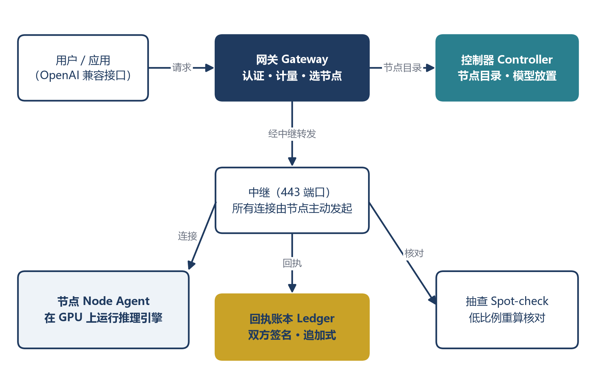
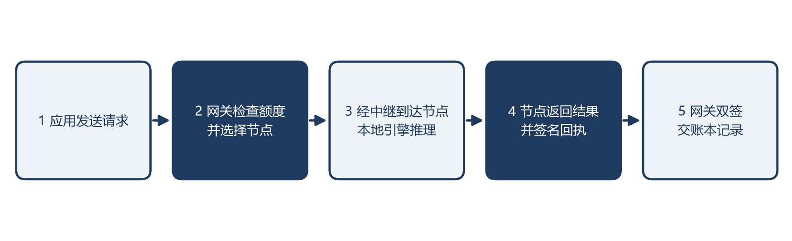

# 百博（Babel）白皮书：可验证的分布式推理网络

可验证的分布式推理网络

百博（Babel）  ·  运营主体：香港公司

v1.0 · 2026-10-29      对外草稿 · 待律师审核

声明：本文是技术与运营设计说明，不是代币发行文件，也不构成任何投资、证券或金融产品的要约。运营主体为香港公司。本网络不发行、不交易任何代币；积分不可转让，也不在用户之间交易。对外发布前须经香港律师审核（见附录 B）。机制的形式化描述与证明见论文《百博：一个可验证的点对点推理网络》。

## 摘要

AI 推理的需求正在快速增长，而且越来越集中在智能体和编程上：一个 200 人的研发团队每天消耗约 167 亿 token。与此同时，大量显卡在多数时间里闲着：家用电脑如此，国内智算中心的平均使用率也只有约 30%–37%。

百博把两端连起来。任何人的显卡都可以接入网络为他人运行模型；网络把请求分给合适的节点，并让每一方都能核对服务记录。四个设计选择：

1. 平台不存储内容。 提示词、回答和文件只在用户与节点之间流动；对话历史保存在用户的浏览器里。

2. 能力先测后用。 节点通过一致性测试才能承接工作；上线后按比例抽样复算。

3. 双签回执与追加式账本。 每次服务由节点与网关双方签名，任何人都可以核对。

4. 延迟结算。 积分经过确认期才能使用，作弊被发现即冻结并没收，使诚实成为节点的最优策略。

这些机制已经实现并在线运行（2026 年 10 月）。

## 1. 问题

- 成本：编程智能体反复读取上下文，人均每天约 8,300 万 token。200 人的团队每月约 5,000 亿 token，全部使用闭源前沿模型，按公开价格估算每月约 245 万–550 万元。

- 数据边界：企业的代码、文档和客户数据，往往不能离开它控制的范围。

- 供给集中：价格、配额与可用性由少数厂商决定；使用者无法验证计算是否按约完成。

- 信任缺失：陌生人的显卡便宜，但没人敢用。代币激励的算力网络大多出现了虚假供给和价格脱钩的问题。

百博不走代币路线。我们解决的是信任问题：让陌生人的显卡给出可以验证的结果。

## 2. 目标与非目标

目标：让任何显卡都能以可验证的方式承接推理；让使用者像调用普通接口一样使用，不必知道哪台机器在干活；让贡献者的每一份工作都被记录和核对。

非目标：不发行代币，不提供交易或二级市场；不替用户选择或审核模型（模型由用户自行下载和部署，许可由用户负责）；不承诺所有节点的质量相同。

## 3. 两类供给

| 供给 | 典型硬件 | 承担的工作 |
| --- | --- | --- |
| 家用节点 | RTX 3090、4090、5090；Apple 芯片；AMD 统一内存平台；只有处理器的电脑 | 聊天、27B 以下模型、短上下文编程、图像、语音、联网搜索 |
| 机构节点 | 算力中心的高显存卡，例如 8×RTX PRO 6000D（单卡 84 GB） | DeepSeek-V4.1-Flash-1017 这类大模型、长上下文编程与智能体 |

两类节点使用同一套程序、协议和准入标准。首期种子供给是向孵化方世纪互联租用的 32 张异构显卡：16 张 RTX PRO 6000D（2 台 8 卡机）、8 张 RTX 5090、8 张 RTX 4090。规模按客户需求倒推，不为凑节点数扩张。

能力在向小参数下沉。 团队判断 1017 的编程能力已达到可用水平；它每个 token 的缓存只需约 890 字节，长上下文的显存代价很小。预计会有参数更少的模型接近这一水平，今天需要 8 卡机器的工作，以后可以下放到家用显卡。网络按能力等级放置工作，能力下沉时，工作随之下放到更多节点。

## 4. 系统架构

图 1　百博（Babel）系统架构

节点：运行在贡献者机器上。检测硬件并测速；按分配启动推理引擎（llama.cpp、stable-diffusion.cpp、ComfyUI、语音识别等，统一通过"引擎描述"接入，新模型不改节点程序）；只监听本机地址，所有对外连接由节点主动发起；为每次服务签署回执。多张 NVIDIA 显卡时每张卡一个节点。

控制器：维护节点目录、模型目录和放置决策。按显存、实测速度和信任级别决定每个模型放在哪些节点、几份副本。控制器只看到节点的能力和负载，看不到用户内容。

网关：对外提供 OpenAI 兼容的接口（`https://babelmesh.ai/v1`）。负责认证与计量；按模型、区域、负载和数据等级选择节点；失败时切换节点，流式输出中途断开时由另一节点接续。

中继：家庭和办公网络里的节点没有公网入口。节点主动连接中继，中继统一在 443 端口转发；节点之间的连接不依赖域名解析。

账本：追加式记录双签回执，只含哈希与用量，不含内容。

## 5. 一次请求的完整流程

1. 应用向网关发送请求（模型名、消息或图片参数，可选数据等级）。

2. 网关检查额度与权限，选出获准处理该数据等级的节点，附上请求编号。

3. 请求经中继到达节点，节点调用本地引擎完成推理。

4. 节点返回结果，并签署回执：请求编号、模型、用量（token、图片数、音频或视频秒数）、时间。

5. 网关核对回执并签名，把双签回执写入账本。

6. 响应带有请求编号，使用者和贡献者都可以凭它查询记录。

图 2　一次请求的完整流程

## 6. 可信机制

### 6.1 准入

节点入网时跑参考基准，由控制器验证后接纳。每种推理引擎接入前还要通过一致性测试：启动、只监听本机、接口正确、结果准确、进程被杀后自动恢复。

### 6.2 抽样复算

网关以概率 r 把请求复制到可信节点上重算并比对，节点无法分辨哪一次是抽查。作弊比例为 f 的节点，n 次请求后仍未被发现的概率是 (1 − r·f)^n：r = 5%、f = 10% 时，1,000 次后约为 0.7%。新的家用节点抽查 20%，连续通过 2,000 次后降到 5%。

### 6.3 延迟结算

积分先按"节点 × 天"进入待确认，确认期默认 7 天。只有双签回执与账本一致的服务才计入。抽查不合格时冻结待确认积分；确认作弊后作废，并按 3 倍扣罚。设单次作弊收益为 s，只要待释放的积分 W > s/r（r = 5% 时约为 20 倍），诚实就是最优策略。

### 6.4 数据等级

请求分为公开、内部、机密、秘密四个等级。家用节点只接收公开等级。没有获准的节点时，网关直接拒绝，不降级发送。

### 6.5 机密计算（测试中）

对保密要求高的数据，规划使用支持机密计算的显卡（如 RTX PRO 6000D）。节点出示远程证明，网关只把机密请求发给通过证明的节点。能力仍在实测，不对外承诺。

### 6.6 局限

抽查是概率性的，不能保证每一次结果都正确；家用显卡的所有者理论上可以读取本机内存，所以家用节点只承接公开数据；机密计算的范围取决于硬件厂商的支持。

## 7. 内容原则与隐私

- 平台不保存提示词、回答和文件，不做内容审核；内容与模型的使用责任由使用者承担。

- 对话历史保存在用户的浏览器里。

- 网络只看到路由所需的元数据（模型名、大小、时间）；用量记录不含身份和内容，并定期用脚本检查日志。

- 节点看不到请求者是谁，请求者也看不到节点所有者的身份。

## 8. 贡献与积分

- 计量的是经验证的工作：token 数、图片数、音频与视频秒数。在线时长本身不产生积分。

- 分成：每个请求费用的 70% 记给提供算力的账户。自己的请求落在自己的节点上不计收入。

- 积分按法币定价，用于抵扣平台上的使用额度；不可转让、不在用户之间交易、不作为支付手段在平台外流通。

- 兑付：代码中已有设计，但在香港律师就积分的法律性质出具意见之前不开放。

为什么不发币：代币激励在海外多个项目中带来了虚假供给、价格与真实使用脱钩；中国大陆对虚拟货币相关业务有明确限制。百博的价值来自可验证的服务，而不是代币价格。

## 9. 安全模型

| 威胁 | 对策 |
| --- | --- |
| 假节点伪造结果 | 准入测试；抽样复算；双签回执；延迟结算与没收 |
| 中间人窃听 | 所有链路加密；节点与网关相互认证 |
| 控制器故障或被攻破 | 加密备份每 5 分钟一次，存于两台异地服务器，恢复已演练；多副本控制器在设计中；控制器不接触内容 |
| 节点泄露内容 | 家用节点只承接公开数据；机密数据依赖远程证明 |
| 账本被篡改 | 追加式结构，第三方可核对 |
| 安装包被替换 | Windows 安装包代码签名，macOS 公证；自动更新清单带签名，校验失败不安装 |
| 密钥泄露 | 密钥只存于受限权限的文件，不写入命令行与日志 |

## 10. 现状（2026 年 10 月）

| 项目 | 状态 |
| --- | --- |
| 节点、网关、控制器、中继、账本 | 在线运行 |
| 准入、抽样复算、延迟结算 | 已实现 |
| 聊天（Qwen3.8-27B 两副本、4B）、代码、文生图、联网搜索 | 已上线，chat.babelmesh.ai |
| 27B 模型，单张 RTX 3090 | 经网关每秒 39.5 token |
| 语音转文字，RTX 4090 | 实时率 0.10–0.13，未上线 |
| 客户端 | 0.3.2，Windows、Linux、macOS |
| 在线节点 | 8 个 |

详细数据见《百博实测报告》。

## 11. 路线图

| 阶段 | 时间 | 同时在线节点 | 内容 |
| --- | --- | --- | --- |
| 0 | 2027 年春节前 | 1 万 | 公测；首期种子显卡；1017 在 8 卡机器上实测并上线 |
| 1 | 2027 年下半年 | 10 万 | 控制面分区；开发者平台；视频能力 |
| 2 | 2028 年 | 50 万 | 区域中继；机密计算推理试用 |
| 3 | 2028–2029 年 | 100 万 | 能力下沉到家用显卡；智能体生态接入 |
| 远景 | 2030 年以后 | 1,000 万 | 12–16 GB 显卡可承担编程类工作 |

每一步都设门槛：供给与需求同步扩张，未达标不扩张。

## 12. 局限与风险

- 本文描述的是设计与实测，不是性能承诺；1017 在 8 卡机器上的吞吐尚未实测。

- 抽查与信誉需要数据积累，早期的防作弊能力有限。

- 控制面目前仍是单主机加备份，多副本尚未完成。

- 合规环境变化可能要求调整积分与结算方式。

## 附录 A：与比特币白皮书的对照

| 比特币 | 百博 | 差异 |
| --- | --- | --- |
| 点对点电子现金 | 点对点推理网络 | 服务对象是推理，不是货币 |
| 工作量证明 | 抽样复算的有用工作 | 不做无用哈希，计量真实推理 |
| 公开账本 | 追加式回执账本 | 记录服务，不记录代币转移 |
| 区块奖励 | 法币计价积分（不可转让） | 不发币 |
| 全网共识 | 抽查与延迟结算 | 不需要全网共识，只需可验证 |

## 附录 B：审核与使用说明

- 对外发布前须经香港律师审核：积分与兑付的表述是否构成证券或虚拟资产相关要约；推广是否涉及其他司法辖区的规定；个人资料的处理。具体问题见《法律与合规问题清单》。

- 涉及中国大陆用户或大陆境内推广时，另请大陆律师审核。

- 任何对外版本不得包含代币、币价、挖矿、收益率、上市等表述。
